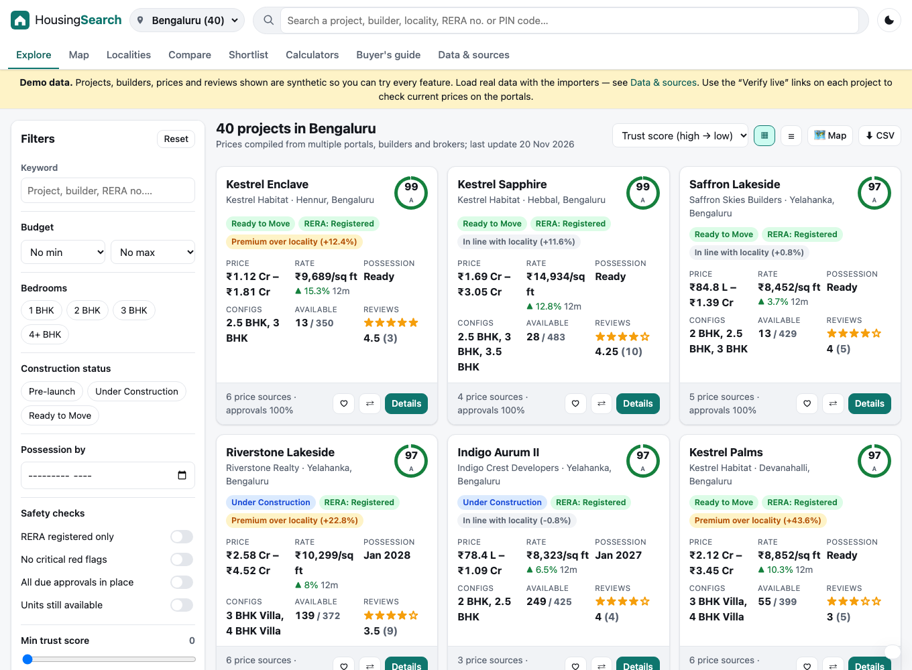
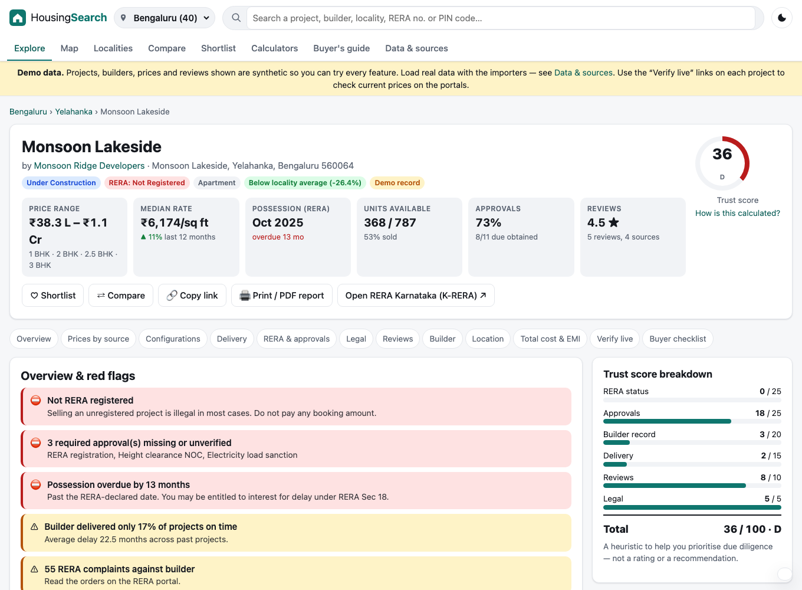
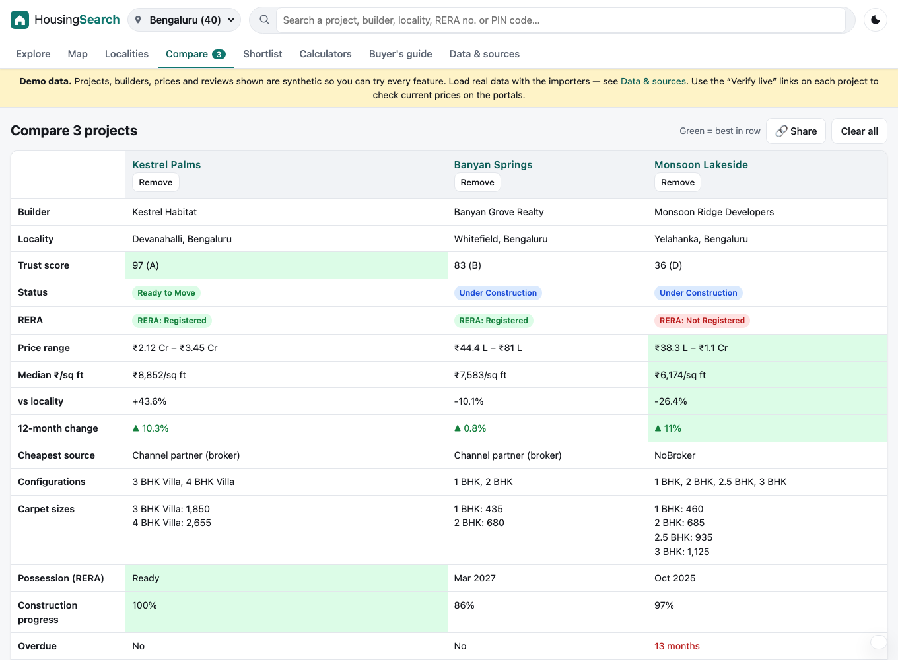
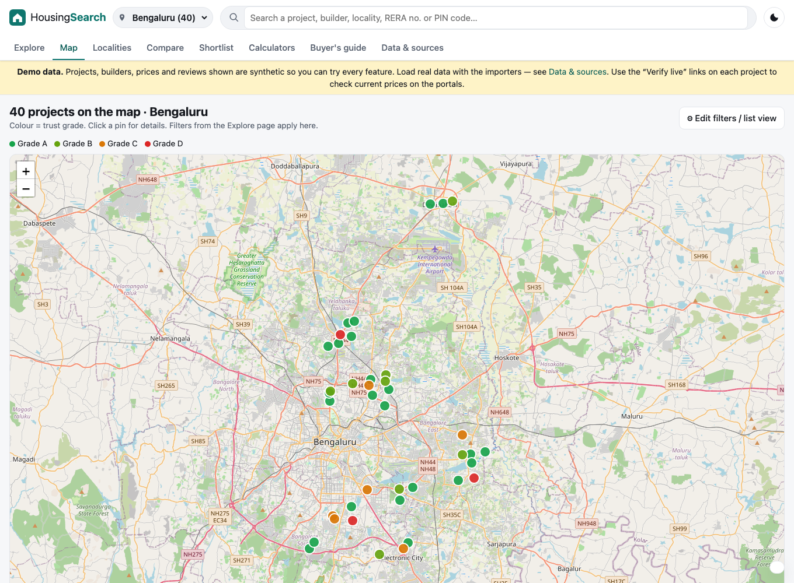
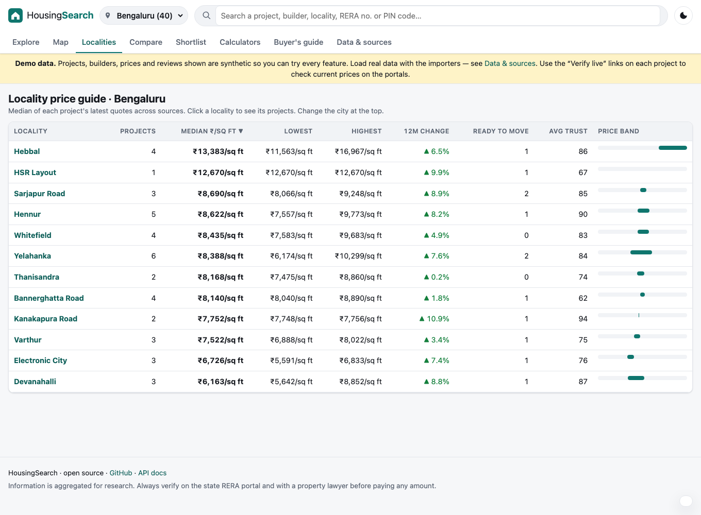

# 🏠 HousingSearch — every project, every price, one place

**HousingSearch** pulls together everything you need to research a residential project in an Indian city, so you don't have to cross-check Housing.com, 99acres, MagicBricks, NoBroker, builder sites, brokers, RERA portals and forums one by one.

Search for any project and see:

| | What you get |
|---|---|
| 💰 **Latest prices by source** | Most recent quote on every portal, builder site and broker — with **where** it was quoted, **when**, the ₹/sq ft, the cheapest source and the % spread between sources. Full price history and a 24-month trend chart. |
| ⚖️ **Fair-price check** | Project ₹/sq ft vs the locality median → *Below average / In line / Premium*. |
| 🏢 **Configurations & availability** | Every BHK type with carpet and super built-up area, loading %, price band, effective carpet-area rate and **units still available**. |
| 📅 **Expected delivery** | RERA (legally binding) vs builder-advertised possession date, construction progress, overdue months, and an "at risk of delay" check. |
| 📜 **RERA status** | Registration number (one-click copy), status (Registered / Applied / Lapsed / Not Registered), authority and a link to the official state portal. |
| ✅ **Government approvals** | A 15-item checklist — title, EC, land-use conversion, plan sanction, commencement certificate, environmental clearance, fire NOC, AAI height NOC, pollution board, water, power, OC, completion certificate, khata — showing **what's obtained, pending, missing, or not yet due**, with the issuing authority for that state. |
| 💬 **Reviews from forums** | Reviews from Reddit, Google Maps, forums, owners' groups and portals, with sentiment, per-source ratings and themes (quality, delays, water, builder behaviour…). |
| ⚠️ **Red flags & trust score** | Automatic flags (unregistered, missing approvals, overdue, poor builder record, open court cases, negative reviews, OC missing on a "ready" project) and a transparent 0–100 trust score. |
| 🏗️ **Builder track record** | Years in business, projects delivered, on-time %, average delay, RERA complaints, all their other projects. |
| ⚖️ **Litigation** | RERA complaints, consumer commission and court cases, with status. |
| 📍 **Location** | Map, nearby metro, schools, hospitals, IT parks, malls, railway and airport distances. |
| 🧮 **True cost & EMI** | All-in cost with GST, state stamp duty (with women's concession), registration, parking, PLC, maintenance deposit — plus EMI, loan and cash needed upfront. |
| 🔗 **Verify live** | One-click searches for the exact project on 7 portals, 5 forums and the RERA portal, so you can confirm today's price at the source. |

And across a whole city:

* **Explore** with 20+ filters: budget, BHK, status, possession date, RERA-only, no red flags, all approvals in place, units available, minimum trust score, locality, price vs locality, property type, size, ₹/sq ft, rating, RERA status, builder, amenities. 10 sort orders. Grid/list views. CSV export. Shareable URLs.
* **Search as you type** by project, builder, locality, RERA number or PIN code — typos are tolerated (`kestrl` → *Kestrel*). Press `/` anywhere to search.
* **Map** of every project, coloured by trust grade.
* **Locality price guide**: median, lowest and highest ₹/sq ft, 12-month change and average trust per locality.
* **Compare** up to 4 projects side by side across 28 rows, with the best value in each row highlighted, plus a shareable link.
* **Shortlist with price tracking**: remembers the price on the day you saved it and shows how it moved since. Private notes per project. CSV export.
* **Calculators**: EMI, affordability (*"how much house can I buy?"*, with a link to matching projects), rent-vs-buy, and a stamp-duty table by state.
* **Buyer's guide**: RERA rights, approvals explained stage by stage, how to read prices, red flags to walk away from.
* Light/dark mode, mobile-friendly, printable project reports (Print → PDF).

> **About the bundled data.** The repository ships with a **synthetic demo dataset** (154 projects across Bengaluru, Mumbai, Pune, Hyderabad, Chennai, Gurugram and Noida) so every feature works the moment you start it. Builders, projects, RERA numbers (prefixed `DEMO-`), prices, reviews and cases are **fictional**; localities, airports, state rules and RERA portal links are real. The UI shows a banner while demo data is loaded. See [Loading real data](#-loading-real-data).

---

## 📸 Screenshots

| Explore | Project page |
|---|---|
|  |  |
| **Compare** | **Map** |
|  |  |



---

## 🚀 Quick start (2 minutes)

You need **Python 3.10 or newer** (check with `python3 --version`). Nothing else: no database server, no Node.js, no build step.

### Option A — one command

**macOS / Linux**
```bash
git clone https://github.com/bhagathchan1/HousingSearch.git
cd HousingSearch
./run.sh
```

**Windows** (Command Prompt or PowerShell)
```bat
git clone https://github.com/bhagathchan1/HousingSearch.git
cd HousingSearch
run.bat
```

Then open **http://localhost:8000** in your browser. 🎉

The script creates a virtual environment in `.venv`, installs the three dependencies, and starts the server. On first start the database (`data/housingsearch.db`) is created and filled with the demo data automatically.

### Option B — step by step

```bash
git clone https://github.com/bhagathchan1/HousingSearch.git
cd HousingSearch

python3 -m venv .venv                 # 1. create an isolated environment
source .venv/bin/activate             #    Windows: .venv\Scripts\activate
pip install -r requirements.txt       # 2. install FastAPI + Uvicorn
python -m housingsearch serve         # 3. start → http://localhost:8000
```

### Option C — Docker

```bash
git clone https://github.com/bhagathchan1/HousingSearch.git
cd HousingSearch
docker compose up --build             # → http://localhost:8000
```
Data is kept in the `housingsearch-data` Docker volume.

### Options

| Want to… | Do this |
|---|---|
| Use another port | `python -m housingsearch serve --port 9000` or `HS_PORT=9000 ./run.sh` |
| Open it to other devices on your network | `python -m housingsearch serve --host 0.0.0.0` |
| Auto-reload while editing code | `python -m housingsearch serve --reload` |
| Use a different database file | `HS_DB_PATH=/path/to/my.db python -m housingsearch serve` |
| Enable the write API | `HS_ADMIN_TOKEN=some-secret python -m housingsearch serve` |
| Reset to fresh demo data | `python -m housingsearch seed --reset` |
| Regenerate the demo dataset | `python scripts/generate_demo_data.py --seed 7` then `python -m housingsearch seed --reset` |
| See what's in the database | `python -m housingsearch stats` |
| Browse the API | http://localhost:8000/docs (interactive Swagger UI) |

### Option D — put it online (free)

[](https://render.com/deploy?repo=https://github.com/bhagathchan1/HousingSearch)

Click the button, sign in to [Render](https://render.com) (free plan), and press **Deploy Blueprint**. In about 5 minutes you get a public link like `https://housingsearch-xxxx.onrender.com`. Free instances sleep after 15 minutes without visitors; the next visit wakes them in about a minute.

Other options (Oracle Cloud Always Free for a permanent server with your own domain, Hugging Face Spaces with a PRO plan) are covered in [docs/DEPLOYMENT.md](docs/DEPLOYMENT.md).

### Troubleshooting

| Problem | Fix |
|---|---|
| `python3: command not found` | Install Python 3.10+ from [python.org](https://www.python.org/downloads/). On Windows tick **"Add Python to PATH"** during install and use `python` instead of `python3`. |
| `Address already in use` | Something else is on port 8000 — use `--port 8001`. |
| Map is blank | The map tiles and Leaflet load from the internet; everything else works offline. |
| `./run.sh: Permission denied` | `chmod +x run.sh` |
| Want to start over | Delete `data/housingsearch.db` and restart. |

---

## 🧭 How to use it

1. **Pick your city** in the top bar.
2. **Search** for a project, builder, locality, RERA number or PIN code — or use the **filters** on the left (tap **⚙ Filters** on mobile).
   Tip: switch on **RERA registered only**, **No critical red flags** and **All due approvals in place** to see only the safest options.
3. **Open a project** to see the full report. Use the section bar to jump to *Prices by source*, *RERA & approvals*, *Reviews*, *Total cost & EMI*, etc.
4. **♡ Shortlist** projects you like — HousingSearch remembers today's price and shows changes the next time you visit. Add notes from site visits.
5. **⇄ Compare** up to 4 projects; use **🔗 Share** to send the comparison to family.
6. Before paying anything, use **Verify live** to confirm prices on the portals and the record on the official RERA site, and go through the **Buyer checklist** at the bottom of each project page.

### How the trust score works

| Component | Max | Based on |
|---|---|---|
| RERA status | 25 | Registered = 25, Applied = 8, otherwise 0 |
| Approvals | 25 | % of due approvals that are obtained |
| Builder record | 20 | Builder's on-time delivery % |
| Delivery | 15 | Full if on track; minus 1 per overdue month; 7 if at risk |
| Reviews | 10 | Share of positive (and half of neutral) reviews |
| Legal | 5 | Minus 2 per open case |

Grades: **A** ≥ 85 · **B** ≥ 70 · **C** ≥ 55 · **D** below. The score helps you decide where to focus your own checks. It is not a rating or a recommendation.

---

## 📥 Loading real data

Portals like Housing.com and 99acres **don't allow automated scraping** in their terms of use, so HousingSearch doesn't scrape them. Instead it imports data you're allowed to use, keeps the source and date of every number, and links you to each portal for live checks. Full guide: [docs/DATA_SOURCES.md](docs/DATA_SOURCES.md).

```bash
# 1. Full project records (RERA details, approvals, configs, quotes, reviews…) as JSON
python -m housingsearch import-json examples/sample_import.json

# 2. Price quotes you collect over time (portals, brokers, builder cost sheets) as CSV
python -m housingsearch import-quotes examples/sample_quotes.csv

# 3. One builder/listing page by URL (reads schema.org data; respects robots.txt)
python -m housingsearch import-url "https://builder.example.com/project" --city Pune --locality Baner

# 4. From another program, over HTTP (requires HS_ADMIN_TOKEN on the server)
curl -X POST http://localhost:8000/api/admin/import \
  -H "X-Admin-Token: $HS_ADMIN_TOKEN" -H "Content-Type: application/json" \
  --data @examples/sample_import.json
```

* Re-importing is safe: projects are matched by slug, then RERA number, then name + locality + city. New price quotes and reviews are **added to the history**, never duplicated.
* Field-by-field format, approval codes and merge rules: [docs/DATA_FORMAT.md](docs/DATA_FORMAT.md).
* To run with **only** real data: `rm data/housingsearch.db`, then import your files (the demo data is loaded only into an empty database; delete `data/seed/demo_properties.json` to disable it entirely).

---

## 🔌 API

Everything in the UI is available as JSON. Interactive docs: **http://localhost:8000/docs**.

| Method & path | Description |
|---|---|
| `GET /api/health` | Status and project count |
| `GET /api/meta` | Cities, localities, builders, amenities, approvals catalogue, state costs |
| `GET /api/properties` | Search & filter (see parameters below), paginated, with facet counts |
| `GET /api/properties/{id}` | Full project report: quotes, insights, approvals, reviews, flags, trust score, verify links |
| `GET /api/properties/export.csv` | Same filters as search, as CSV |
| `GET /api/suggest?q=` | Autocomplete for projects and localities (typo-tolerant) |
| `GET /api/compare?ids=1,2,3` | Up to 4 full reports |
| `GET /api/localities/{city}` | Locality price statistics |
| `GET /api/builders/{id}` | Builder profile and projects |
| `POST /api/admin/import` | Import JSON records (`X-Admin-Token` header) |
| `POST /api/admin/import-url` | Import one URL `{"url": "...", "city": "..."}` |

**Search parameters:** `q`, `city`, `locality`, `builder`, `property_type`, `status`, `rera_status`, `bhk` (`1,2,3,4` where 4 = 4+), `min_price`, `max_price`, `min_size`, `max_size`, `min_psf`, `max_psf`, `possession_by` (`YYYY-MM`), `min_trust`, `min_rating`, `amenities`, `fair_price`, `rera_only`, `no_red_flags`, `all_approvals`, `available_only`, `sort` (`relevance`, `trust`, `price_asc`, `price_desc`, `psf_asc`, `psf_desc`, `possession`, `rating`, `appreciation`, `name`), `page`, `page_size`. Multi-value filters take comma-separated values.

```bash
curl "http://localhost:8000/api/properties?city=Bengaluru&bhk=3&max_price=15000000&rera_only=1&sort=psf_asc"
```

---

## 🗂️ Project structure

```
HousingSearch/
├── housingsearch/            Python package (backend)
│   ├── api.py                FastAPI app: JSON API + serves the web UI
│   ├── repository.py         search index, filters, fuzzy search, data merge
│   ├── insights.py           prices, fair price, delivery, approvals, reviews, red flags, trust score
│   ├── catalog.py            approvals checklist, RERA portals, stamp duty/GST by state
│   ├── ingest.py             JSON / CSV / URL importers
│   ├── db.py                 SQLite schema
│   ├── cli.py                command line (serve, seed, import-*, stats)
│   └── config.py             settings via environment variables
├── web/                      frontend (no build step)
│   ├── index.html
│   ├── css/styles.css        light + dark themes, responsive
│   └── js/                   app.js (router), api.js, state.js, util.js, charts.js, views/*
├── data/seed/demo_properties.json   synthetic demo dataset
├── scripts/generate_demo_data.py    regenerates the demo dataset
├── examples/                 sample JSON and CSV import files
├── tests/test_app.py         API, importer and analytics tests
├── docs/                     ARCHITECTURE.md, DATA_FORMAT.md, DATA_SOURCES.md, DEPLOYMENT.md, screenshots
├── run.sh / run.bat          one-command start
├── Dockerfile, docker-compose.yml   (also used by Render / Hugging Face)
├── render.yaml                      one-click Render deploy
├── scripts/deploy_hf.sh             Hugging Face Spaces deploy (needs PRO)
└── .github/workflows/        tests.yml (CI on Python 3.10–3.13), deploy-hf.yml (optional HF auto-deploy)
```

Architecture notes: [docs/ARCHITECTURE.md](docs/ARCHITECTURE.md).

---

## 🧪 Development

```bash
pip install -r requirements-dev.txt
pytest -q                               # 20 tests: API, filters, importers, analytics
python -m housingsearch serve --reload  # auto-restart on code changes
```

Or with `make`: `make dev`, `make test`, `make run`, `make seed`, `make docker`.

**Adding a city:** add it to `CITY_STATE` (and its state to `STATES`, with RERA portal and stamp duty) in `housingsearch/catalog.py`, then import projects for it.

---

## 🗺️ Roadmap ideas

- Email/WhatsApp alerts when a shortlisted project's price drops or its RERA status changes
- Per-state RERA portal importers (where the portal publishes data openly)
- Resale and rental listings alongside new launches; rental yield per locality
- Floor-plan images and brochure PDFs per configuration
- Postgres + Meilisearch backend for nationwide scale
- User accounts to sync shortlists across devices

Contributions welcome. Open an issue or a pull request.

---

## ⚠️ Disclaimer

HousingSearch puts information in one place for research. It is **not** legal or financial advice, and data can be incomplete or out of date. Before paying any amount, check the project on your **state RERA portal**, get the title documents checked by a **property lawyer**, and get an all-inclusive cost sheet from the builder in writing. Stamp duty, registration and GST figures are indicative.

## 📄 License

[MIT](LICENSE)
